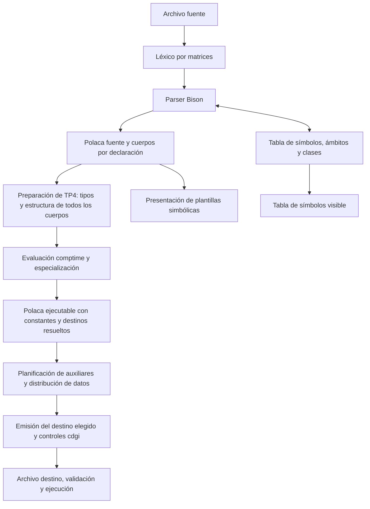

# Plan para terminar el compilador del grupo 24

Fecha: 4 de noviembre de 2026. Estado: plan ajustado con las decisiones explícitas
del grupo. Revisión: compatibilidad estática de accesos variables y arquitectura
preparada para una alternativa futura. Este ajuste modifica únicamente este
documento. Complementa [REQUERIMIENTOS_TP.md](REQUERIMIENTOS_TP.md)
y el [informe de funciones](INFORME_FUNCIONES_COMPILADOR.md).

Esta revisión prevalece sobre las decisiones pendientes y alternativas del informe
de funciones y del análisis anterior; esos documentos se conservan como estaban
por el pedido de ajustar sólo el plan. Sus contratos futuros se sincronizarán
al implementar.

El objetivo es entregar un compilador completo de las cuatro etapas, que genere
programas ejecutables y que ambos integrantes puedan recorrer y explicar.
Se conservará lo que ya cumple y se cambiará lo necesario mediante pasos pequeños,
cada uno con un resultado comprobable.

## 1. Verificación de las exigencias

Se volvieron a leer los PDF originales disponibles en
`/home/rodrigo/facultad/compi`: `Tp01-2026.pdf`, `Tp02-2026.pdf`,
`Tp03-2026.pdf` y `Tp04-2026.pdf`. También se contrastaron las filminas de
generación, name mangling, conversiones y WebAssembly con el código actual.

La lista de temas se encuentra en README e informe del grupo; no está disponible
la planilla original del Aula Virtual. Las otras dos asignaciones sí aparecen
expresamente en los enunciados: grupo 24 en Polaca Inversa, TP3 p.1; controles
`cdgi`, TP4 p.2. La entrega TP3/TP4 es conjunta y TP4 indica 13/11/2026;
no se verificaron posibles cambios posteriores comunicados por el docente.

Referencias locales de esta revisión (páginas físicas de los PDF):

- [TP1](/home/rodrigo/facultad/compi/Tp01-2026.pdf),
  [TP2](/home/rodrigo/facultad/compi/Tp02-2026.pdf),
  [TP3](/home/rodrigo/facultad/compi/Tp03-2026.pdf) y
  [TP4](/home/rodrigo/facultad/compi/Tp04-2026.pdf).
- [Name Mangling 08.4](</home/rodrigo/facultad/compi/08.4.Name Mangling.pdf>),
  pp.10–11: identidad por ámbito.
- [Generación UNC.10.1](</home/rodrigo/facultad/compi/UNC.10.1.Generación de Código AS-Ass PI-Ass T-Ass.pdf>),
  pp.8–10: pila de traducción, auxiliares, prefijos y alta en TS.
- [Generación 10.2](</home/rodrigo/facultad/compi/10.2.Generación de Código AS-Ass PI-Ass T-Ass.pdf>),
  pp.41–43: destinos de Polaca y alternativas de generación de etiquetas.
- [WebAssembly 2026](/home/rodrigo/facultad/compi/WebAssembly2026.pdf),
  pp.6–17: tipos, herramientas, operaciones, conversiones, llamadas, saltos,
  carga e impresión mediante funciones JavaScript importadas.
- [Introducción UNC.01](</home/rodrigo/facultad/compi/UNC.01.Introducción a los Compiladores.pdf>),
  p.37: recursión indirecta.
- [Pentium 11.1](/home/rodrigo/facultad/compi/11.1.Assembler_Pentium_Sintaxis.pdf),
  p.17: flags de overflow; [conversiones 11.2](/home/rodrigo/facultad/compi/11.2.Assembler_Pentium_Conversiones.pdf),
  pp.16–18: conversiones de representación. Fundamentan las distinciones de
  tipos y máquina, sin imponer instrucciones Pentium al destino WebAssembly.

Las rutas Desktop/Uni citadas en la crítica no existen en este workspace;
se consultaron los materiales equivalentes presentes en las rutas anteriores.

| Identificador | Exigencia y criterio de aceptación | Fuente |
| --- | --- | --- |
| G01 | Léxico mediante matrices; identificadores minúsculos hasta 22 caracteres, truncamiento con warning; reservadas sin distinguir mayúsculas. | TP1 pp.1–2 |
| G02 | TS dinámica; referencias estables devueltas mediante `yylval`; tipos, usos, ámbitos y metadatos. | TP1 p.1; TP2 p.9; TP3 pp.1–3,5 |
| G03 | Parser generado, sintaxis general, recuperación y cero conflictos de ambos tipos. | TP2 pp.1–3,9 |
| G04 | Declaración previa, visibilidad léxica, shadowing, redeclaración y uso correcto de símbolos. | TP3 pp.2–3 |
| G05 | Polaca dinámica y numerada; todas las sentencias; cuerpo visible por función y método. | TP3 pp.1,5,12 |
| G06 | Parámetros por copia, cantidad y correspondencia correctas; retornos anticipados y por defecto. | TP2 pp.1–2; TP3 p.5 |
| G07 | Diagnósticos con línea y descripción; TS e IR legibles; trazas opcionales. | TP2 p.9; TP3 p.12; TP4 p.3 |
| G08 | Tipos compatibles al traducir Polaca a destino; sin conversiones implícitas del tema 35. | TP3 p.4; TP4 p.3 |
| G09 | Código destino mediante auxiliares; procesable y ejecutable; archivo de salida. | TP4 pp.1,3 |
| G10 | Fuentes, ejecutable, dependencias, pruebas, informe y registro de IA; explicación del desarrollo. | TP1 p.2; TP2 p.9; TP4 p.4 |
| T03 | INTEGER con signo de 16 bits y `$i`, incluidos los dos extremos válidos. | TP1 p.3; TP2 p.9 |
| T07 | SINGLEF de 32 bits, formato y rango especificados, exponente `s`. | TP1 p.3 |
| T10 | Cadenas multilínea entre comillas, sin saltos en TS. | TP1 p.3 |
| T14 | FROM con constantes INTEGER, comparación estricta y actualización posterior. | TP2 pp.3–4; TP3 p.6 |
| T15 | Comentarios `//`. | TP1 p.3 |
| T18 | Asignar identificador o constante con `=` dentro de expresiones y conservar el valor. | TP2 p.4; TP3 p.7 |
| T19 | Orden obligatorio de evaluación y copia, sin cambiar la posición del formal. | TP2 p.4; TP3 p.7 |
| T22 | Evaluación y sustitución `comptime`, incluidos los parámetros de los ejemplos. | TP3 p.8 |
| T24 | Clases con código; verificar estructuras compatibles y copias admitidas. | TP2 pp.5–6; TP3 p.9 |
| T29 | Atributos por posición desde cero; índice constante o variable; existencia y visibilidad. | TP2 p.7; TP3 p.10 |
| T32 | Herencia múltiple; declaración propia antes que heredadas; error por homónimos ambiguos. | TP3 pp.10–11 |
| T34 | `toi(SINGLEF)` produce INTEGER y se traduce a código destino. | TP2 p.8; TP3 p.4; TP4 p.3 |
| EC | Error y terminación por overflow en suma SINGLEF. | TP4 pp.1–2, control c |
| ED | Error y terminación por overflow en producto INTEGER. | TP4 pp.1–2, control d |
| EG | Error y terminación por pérdida de información al convertir flotante a entero. | TP4 pp.1–2, control g |
| EI | Error y terminación por invocación recursiva. | TP4 p.2, control i |
| L01 | Código legible, responsabilidades claras y explicación de cada función. | Pedido del grupo en esta conversación |

No corresponden temas alternativos como WHILE, AUTO, enumeraciones, amistad,
import/export o conversiones implícitas. Según las decisiones locales registradas,
ningún integrante pertenece al plan 2011: Reducción Simple no aplica.

## 2. Estado comprobado y problemas que debe resolver el plan

Se compiló una copia aislada de los fuentes y headers en `/tmp`, mediante el
`build.sh` existente. Bison terminó sin conflictos y GCC con
`-Wall -Wextra -Werror`. Sobre ese binario se aprobaron 107 comprobaciones del
verificador original y 340 ejecuciones de los 170 escenarios de cátedra.
El reporte de esta revisión está en `/tmp/replan-resultados-tp3.json`.
Estos resultados corresponden a TP3; no se ejecutaron sanitizers nuevamente.

El código propio del compilador tiene 190 funciones entre archivos C y los dos
ayudantes escritos en `grammar.y`. Hay 1.098 líneas en `specialize.c`, que reúne
valores, entornos, objetos, dependencias, control y especializaciones. Esa mezcla
es el principal punto a ordenar. También conviene separar clases de ámbitos en
`scope.c`, y distinguir la generación de Polaca de la futura emisión de destino.

Pendientes concretos:

- Backend, chequeo general de tipos, auxiliares, representación de datos,
  llamadas, entrada/salida y controles EC/ED/EG/EI.
- Visualización de plantillas `comptime` sin invocar y validación de sus cuerpos.
- Pruebas permanentes para capturas de objetos anidados y una comprobación
  independiente de sus resultados al ejecutar el código generado.
- Revisar incompatibilidades en código que la especialización elimina: ramas
  conocidas, código tras RET y funciones sin invocar. Un error de tipos no debe
  desaparecer porque sólo se revise la Polaca ejecutable resultante.
- Implementar los contratos ya elegidos: selección y control del índice en
  ejecución, compatibilidad estática de todos los atributos seleccionables y
  detección de pérdida de fracción en TOI. La comprobación dinámica de tipos
  queda como alternativa futura, fuera de la implementación inicial.
- Actualizar informes, pruebas de TP4 y paquete de entrega. `docs/` está ignorado
  por Git: no alcanza con tener un informe local para que llegue a la entrega.

## 3. Arquitectura propuesta

Se mantienen C, Bison y la biblioteca estándar de C. Las matrices del léxico y la
TS dinámica continúan. La representación intermedia del grupo sigue siendo
Polaca, sin agregar un AST ni sustituirla por tercetos.



El chequeo de tipos se ubica en la preparación de la traducción Polaca → destino,
como exige la cátedra. En modo TP3 continúa diferido. En modo completo se valida
primero la Polaca fuente, sin ejecutarla ni necesitar valores para los formales
`comptime`; después se especializa y se comprueba la integridad del resultado.
Así se conservan los límites de etapa y no se ocultan errores de código eliminado.

### Módulos y cambios permitidos

| Módulo | Responsabilidad y criterio de separación |
| --- | --- |
| `main.c` y nuevo `compiler.c` | Opciones, apertura de archivos, orden de etapas, resultado y liberación. Sin operaciones semánticas propias. |
| `lexer.c`, `transition_table.c`, `semantic_actions.c` | Entrada, reconocimiento por matrices y alta de lexemas. Mantener la parte que ya funciona. |
| `diagnostics.c` | Diagnósticos, origen y recuperación; sin decidir tipos, herencia ni almacenamiento. |
| `symbol_table.c` | Poseer símbolos y referencias estables. Conservar los nombres visibles y metadatos requeridos. |
| `scope.c` | Declarar, abrir/cerrar ámbitos y resolver nombres; delegar herencia y esquemas a clases. |
| nuevo `classes.c` | Bases, miembros, atributos efectivos, ambigüedad y descripción estructural. Devuelve candidatos por posición sin asignar direcciones. |
| `grammar.y` | Reconocer construcciones y llamar funciones pequeñas; conservar guardas y destructores. |
| `rpn.c` | Almacenar, unir, reubicar, validar e imprimir pasos y metadatos de control. |
| actual `codegen.c`, a renombrar `ir_builder.c` | Construir Polaca y cuerpos fuente desde el parser. El nombre nuevo evita confundirlo con el backend. |
| nuevo `types.c` | Tipos, reglas de compatibilidad y validación de todos los cuerpos fuente. Decide si un uso admite todos sus candidatos; no emite WAT. |
| nuevo `numeric.c` | Rangos, redondeo y operaciones numéricas para evaluación de compilación; especificación común que debe reproducir el emisor con instrucciones WAT. |
| nuevo `comptime_values.c` | Valores conocidos/desconocidos y entornos de compilación; delega las operaciones numéricas a `numeric.c`. |
| nuevo `comptime_objects.c` | Identidad de campos, copia por posición y capturas de campos `comptime`. |
| `specialize.c` reducido | Recorrer cuerpos y control; administrar instancias, dependencias y efectos usando los dos módulos anteriores. |
| nuevo `layout.c` | Reserva de auxiliares y ubicaciones de globales, locales, formales, atributos y marcos. Produce un plan de almacenamiento completo antes de escribir WAT. |
| nuevo `wasm_emit.c` | Escribir instrucciones y control estructurado, sin reinterpretar las reglas de tipos. |
| `runtime/` | Soporte pequeño de salida, errores y ejecución del programa generado. No interpreta el lenguaje fuente. |

Cada módulo tendrá su header público; las funciones internas seguirán siendo
`static`. No se dividirá cada ayudante en su propio archivo. La extracción de
`specialize.c` se hará por responsabilidad, manteniendo sus pruebas y resultados.

### Estructuras y propiedad de memoria

- **Símbolo:** mantiene identidad estable y declaración. Los tipos se consultan
  mediante `type_t`, con un enum y una referencia de clase cuando corresponda.
  Durante la migración se conserva la impresión histórica de tipos.
- **Programa:** contiene TS, Polaca principal, cuerpos fuente y cuerpos
  especializados. Los cuerpos pertenecen al programa, no al impresor.
- **Paso de Polaca:** operación, referencias, línea y origen. El origen identifica
  el paso fuente incluso después de expandir un ciclo.
- **Análisis de acceso:** cuerpo/paso origen, receptor, índice y lista de campos
  candidatos con identidad y tipo; distingue valor de destino de escritura.
  Se conserva como metadato de Polaca, sin convertir los valores ordinarios en
  valores dinámicos. `types` añade el resultado de compatibilidad del uso.
- **Control:** enum IF/FROM y límites de condición/cuerpo/ELSE/salida, con metadatos
  de variable y constantes FROM. Es información asociada a Polaca, no otro IR.
- **Valor de compilación:** conocido o desconocido y tipo explícito. El desconocido
  nunca se confunde con cero. Separar valor de información sobre fragmentos emitidos.
- **Entorno de compilación:** vector de asociaciones por símbolo y objeto. Separado
  de las ubicaciones de memoria que usará el ejecutable.
- **Captura de objeto:** colección de pares campo/valor y campo/captura hija,
  evitando listas paralelas que podrían quedar con cantidades diferentes.
- **Ubicación de ejecución:** clase de almacenamiento, desplazamiento y tipo.
  La calcula `layout`, sin añadir offsets de un destino a las reglas de alcance.

El programa posee TS y cuerpos; los pasos toman prestadas sus referencias.
Los contextos de evaluación poseen entornos y pilas temporales; las capturas
retenidas tienen un propietario único explícito. Destruir primero los contextos
y cuerpos, después los símbolos. Cada interfaz documentará si consume, presta
o devuelve memoria propia. No se editarán `y.tab.c` ni `y.tab.h` a mano.

### Reglas de legibilidad

1. Nombres y comentarios del código en inglés, como el proyecto; explicaciones
   del informe en español. Nombres que indiquen qué se hace y sobre qué dato.
2. `struct`, `enum`, arrays dinámicos, listas y `switch` explícitos. Usar punteros
   a función donde ya corresponden a la matriz semántica, sin extender ese patrón
   a una arquitectura de plugins o despachos genéricos.
3. Una responsabilidad por función. Separar especialmente los casos del `switch`
   de especialización; unas 30–60 líneas es una referencia, no una cuota que
   obligue a fragmentar operaciones simples.
4. No ocultar cambios de estado en macros. Mantener las macros de integración
   con Bison sólo donde su mecanismo de recuperación lo necesite y explicarlas.
5. Preferir parámetros y contextos concretos a nuevas variables globales.
   No convertir de una vez todas las firmas existentes: migrar por módulo.
6. Evitar contenedores genéricos con `void *`, frameworks, LLVM, generación de C
   como atajo al backend, metaprogramación y optimizaciones no exigidas.
7. Los comentarios explican decisiones y restricciones; los pasos normales deben
   entenderse por el nombre y el cuerpo de la función.
8. Cambiar una regla de tipos en `types`, un orden de campos en `classes`, una
   ubicación en `layout` o una instrucción en el emisor, sin duplicar esa decisión
   en la gramática, el especializador y el runner. Las reglas numéricas viven en
   `numeric`; las instrucciones equivalentes y los controles cdgi en el emisor.
9. Evitar booleanos que cambien varias responsabilidades de una función. Usar
   nombres concretos, resultados explícitos y, sólo para alternativas reales,
   un enum pequeño. La posibilidad futura de otra política no justifica
   implementar un sistema de plugins ni ramas incompletas accesibles al usuario.

### Revisión de mantenibilidad del resto de la arquitectura

La separación propuesta es viable con C y estructuras convencionales, pero los
nombres de los archivos no bastan para asegurar legibilidad. Estos contratos
resuelven los puntos que aún podían obligar a tocar módulos ajenos a un cambio:

| Punto revisado | Riesgo encontrado | Ajuste y evidencia esperada |
| --- | --- | --- |
| Reglas numéricas | `comptime` y Wasm podrían calcular distinto. | Una especificación en `numeric`, casos de frontera con expectativas explícitas y comparación con el programa Wasm real. Compartir la regla no significa ejecutar C desde Wasm. |
| Clases y layout | Duplicar posiciones, compatibilidad y offsets en resolución, copia y emisor. | `classes` posee identidad/orden/esquema; `types` decide admisibilidad; `layout` asigna bytes. Probar copia entre esquemas y un método con base que no sea la primera. |
| Tipos y especialización | Errores ocultos por eliminar ramas o funciones. | Validar todos los cuerpos fuente; especializar en cuerpos separados; después verificar integridad, conservación de metadatos y tipos concretos. |
| Auxiliares y declaraciones WAT | Descubrir un temporal cuando ya se imprimió el cuerpo o fijó el marco. | Planificar y registrar todos los temporales antes de emitir WAT. El tamaño de marco y los nombres quedan cerrados al terminar `layout`. |
| Llamadas | Confundir padre léxico, llamador y marcos pendientes de argumentos. | Convención de marcos única, epílogo único y recorridos explicados con llamadas anidadas y efecto en parámetros. |
| IR y control | Duplicar saltos numéricos y regiones IF/FROM que después no coincidan. | Polaca como representación central; regiones y análisis como metadatos. Verificar destinos y regiones después de construir y después de especializar. |
| Errores | Continuar con cuerpos parciales tras una recuperación sintáctica. | Marcar cuerpos inválidos; permitir reunir diagnósticos, pero bloquear especialización/emisión del programa cuando hay errores. Liberación común desde el coordinador. |
| Estado y memoria | Un contexto enorme o referencias invalidadas al crecer vectores. | Contextos de cada etapa con dueño y duración explícitos; referencias estables a símbolos y cuerpos; índices para elementos de vectores que pueden realocarse. |
| Tamaño de módulos | Trasladar el monolito a otro archivo o fragmentarlo en decenas de wrappers. | Extraer responsabilidades completas; funciones que expresen operaciones del lenguaje; revisar con recorridos de ejemplos, no con una cuota de líneas. |
| Cambios futuros | Hacer configurable todo desde ahora. | Concentrar decisiones en funciones concretas y conservar la información necesaria. Agregar una alternativa sólo cuando exista una necesidad implementada y probada. |

Estas son decisiones de ingeniería para satisfacer L01 y hacer verificables
G02/G05/G08/G09, no restricciones adicionales atribuidas a la cátedra. Los
fundamentos del lenguaje siguen siendo los enunciados y las referencias del
apartado 1; la organización de archivos no está prescrita por ellos.

### Recorrido concreto de las etapas y sus contratos

El punto de entrada de coordinación, por ejemplo `compiler_run`, debe poder
leerse de arriba abajo siguiendo este orden, con tratamiento de error visible:

1. Inicializar programa, opciones y diagnósticos; analizar fuente. Obtener símbolos,
   cuerpos fuente y regiones de control completos, o diagnósticos de análisis.
2. Verificar integridad de la Polaca y, en modo completo, validar los tipos de todos
   los cuerpos fuente. Conservar análisis de accesos por cuerpo/paso. En TP3 se
   mantiene el diferimiento requerido de tipos; no activar toda TP4 desde el parser.
3. Especializar sin destruir cuerpos fuente; conservar origen y reconstruir las
   asociaciones de metadatos cuando se duplican/reubican pasos. Verificar Polaca
   ejecutable, destinos, referencias, llamadas y sustituciones `comptime`.
4. Preparar datos y temporales: recorrer la Polaca ejecutable con la pila del
   traductor para identificar resultados, snapshots, destinos y reservas. Registrar
   auxiliares en TS y calcular ubicaciones y tamaño de cada marco. Guardar referencias
   por paso en un plan de almacenamiento, sin crear otro conjunto de instrucciones.
5. Emitir WAT leyendo Polaca, regiones, análisis y ubicaciones ya cerradas.
   `wasm_emit` no modifica ámbitos, no agrega símbolos ni vuelve a inferir tipos.
   Puede dividirse internamente en funciones `emit_*` de datos, expresiones,
   control y llamadas, manteniendo un solo archivo hasta que su tamaño lo justifique.
6. Cerrar/publicar la salida sólo si no hubo error. Mostrar TS final con auxiliares;
   liberar contextos y programa en el orden de propiedad previsto. Conversión WABT
   y ejecución se comprueban con comandos/runner documentados, propagando fallos.

Los resultados de cada etapa tienen estructura y estado explícitos. Un análisis
no hecho o un cuerpo inválido no se representa como un tipo INTEGER por defecto.
`compiler.c` ordena las etapas; ningún módulo ejecuta de forma oculta la siguiente.
Los contextos comparten referencias concretas al programa, no un contexto global
con estado mutable de todas las etapas. Los encabezados públicos exponen sólo
los datos/operaciones que sus consumidores necesitan; evitar dependencias circulares.

### Lectura del código y documentación que deberán acompañar cada cambio

El informe de funciones tendrá, para cada función pública y cada ayudante propio:
propósito en una frase, entrada y salida, propietario de memoria, estado que puede
modificar, error que puede producir, requisito satisfecho y quién la llama. Si una
función sólo apoya infraestructura, vincularla a la función/requisito que permite;
no inventar un requisito de cátedra distinto para cada reserva de memoria.
Para un caso que lo necesite, incluir un ejemplo corto antes/después del dato.

Añadir al informe un índice de módulos y los recorridos del apartado 8 con nombres
reales de funciones y muestras de Polaca/TS/WAT. Explicar al introducirlos los
conceptos de marco, enlace léxico, captura, auxiliar y epílogo. Un lector debe poder
seguir una asignación antes de tener que entender herencia o especialización.
Actualizar el informe junto a las funciones modificadas durante la implementación.

La refactorización se hará de a una responsabilidad, manteniendo verificaciones
existentes y comparando salidas antes/después. Evitar una reescritura global previa
al primer programa Wasm. Separar cambios de estructura de cambios semánticos para
poder localizar qué alteró un resultado. Revisar el diseño al completar cada paso:
ambos integrantes deben poder seguir un caso y ubicar la regla que lo decide.
La mantenibilidad queda acreditada por esos recorridos y contratos además de las
pruebas funcionales; no se garantiza simplemente por tener muchos módulos.

## 4. Destino elegido y traducción directa

El grupo eligió **WebAssembly**. El compilador emitirá `.wat`; WABT lo convertirá
a `.wasm` para validación y ejecución. Se entregarán ambos artefactos y el soporte
JavaScript. TP4 p.1 permite expresamente este destino; `WebAssembly2026.pdf`
pp.2,7,16 explica los formatos y su conversión. Instalar herramientas es un
prerrequisito operativo, no la implementación del generador.

Para una defensa directamente reproducible con los apuntes, habrá un lanzador
HTML/JavaScript mínimo como el de WebAssembly pp.16–17. Para automatizar las
pruebas se usará además Node con los mismos imports y mensajes. Node es una
adaptación de entorno elegida por el proyecto; no es una herramienta exigida por
la cátedra. El soporte sólo carga el módulo, muestra salidas y termina ante error.

El control de WebAssembly es estructurado mediante `block`, `loop` e `if`;
su uso se basa en la [especificación oficial](https://webassembly.github.io/spec/core/syntax/instructions.html).
Los metadatos IF/FROM permiten traducir directamente nuestras construcciones,
sin un bucle despachador con contador de programa. La conversión textual y la
validación pueden hacerse con [WABT](https://github.com/WebAssembly/wabt).
En este entorno están GCC, Bison y Node; no se encontraron `wat2wasm`,
`wasm-validate`, `wasm-interp`, `wasmtime` ni Wine en PATH. Incorporar herramientas
y fijar sus versiones será parte de la implementación, no de este cambio documental.

### Nombres, auxiliares y bifurcaciones: incorporación de la crítica

La crítica es correcta sobre la necesidad de un backend real, auxiliares,
etiquetas y pruebas ejecutables. MASM32/80X87 corresponde a la alternativa
Pentium. Nuestra elección cumple el objetivo mediante WAT/WASM, admitido por
TP4 p.1. Instalar herramientas no sustituye la generación del programa.

`08.4.Name Mangling.pdf` pp.10–11 explica identidad por ámbito, no sintaxis MASM
ni nombres finales WAT. `UNC.10.1` p.10 fundamenta distinguir variables y
auxiliares mediante prefijos y registrar auxiliares en TS. `WebAssembly2026`
pp.8,11–14 ilustra nombres `$a`, `$f5` y etiquetas `$loop`.

Adoptar una tabla explícita por identidad de símbolo/cuerpo:

| Identidad interna | Nombre destino ilustrativo | Regla |
| --- | --- | --- |
| `x:main` | `$v_17` | ID estable del símbolo. |
| `x:main:f` | `$v_31` | Otro símbolo, otro ID. |
| `f:main$ct2` | `$fn_42` | Instancia con enlace a su función fuente para i. |
| Auxiliar del cuerpo 42, ordinal 3 | `$tmp_42_3` | Namespace separado, registro de tipo, dueño y origen en TS. |
| Destino local 18 del cuerpo 42 | `$label_42_18` | Identidad por cuerpo y posición, sin colisión entre funciones. |

Los nombres concretos son una convención basada en los ejemplos WAT. Conservar
la correspondencia en TS o metadatos asociados para explicar la salida.
No afirmar que `:` sea inválido en WAT por analogía con MASM. Tampoco reemplazar
sólo `:` por `_`: eso puede colisionar con nombres que ya tengan `_`. Asignar IDs
en orden de declaración, con orden fijo para los generados, hace reproducible
la traducción. El emisor recibe referencias de TS, no vuelve a analizar los
nombres impresos por `rpn_print`.

Para bifurcaciones, adaptar la marcación de destinos de `10.2.Generación de
Código AS-Ass PI-Ass T-Ass.pdf` pp.41–43 al control de WebAssembly pp.12–15:

1. Reunir destinos BF/BI de cada cuerpo, incluido count+1.
2. Asociarlos a regiones IF/FROM y etiquetas únicas por cuerpo.
3. Emitir block/loop/if: salir de block lleva al final; saltar a loop vuelve a
   su cabecera. No confundir esas dos clases de destino.
4. Verificar accesibilidad estructural de cada etiqueta y pila coherente.
   Conservar tabla paso Polaca → región/etiqueta → ubicación WAT.
5. Ejecutar IF/ELSE y ciclos anidados y retornos tempranos. Un destino numérico
   válido de Polaca no demuestra por sí solo que el salto WAT sea válido.

### Auxiliares, valores y orden de evaluación

La pila del traductor contiene referencias a valores ya calculados y a destinos.
Cada operación emite una asignación a un auxiliar explícito (`aux1`, `aux2`, ...).
Aunque WebAssembly ejecute instrucciones de pila, el método de generación sigue
siendo el de auxiliares exigido en TP4. No generar el cálculo de una expresión
entera usando solamente la pila de la máquina destino.

Registrar cada auxiliar en TS con uso propio, tipo, cuerpo y paso fuente, y
mostrarlo en la TS final de TP4. `UNC.10.1` pp.8–10 prescribe desapilar operandos,
generar la operación con auxiliar y apilar ese auxiliar. Por ejemplo, para
`a b + c *`: `tmp1 := a+b`, luego `tmp2 := tmp1*c`. Las copias preventivas de
operandos mutables sirven para conservar el orden y los efectos del lenguaje.

Ejemplo conceptual: `a := b + 2$i * c;`:

```text
aux1 := valor de b en su punto de evaluación
aux2 := valor de c en su punto de evaluación
aux3 := 2$i * aux2
aux4 := aux1 + aux3
a := aux4
```

Guardar el valor de un operando mutable antes de evaluar el siguiente: una llamada
posterior puede cambiar b o c. `DUP` duplica la referencia al mismo valor calculado,
no vuelve a leer la variable. `DROP` descarta un valor conservando sus efectos.

INTEGER mantiene semántica de 16 bits aunque se procese con `i32`; SINGLEF usa
`f32`. Especificar almacenamiento, extensión de signo, redondeo, división entera
y tratamiento de resultados fuera de rango según el contrato numérico cerrado
del apartado 5. Los desbordes ajenos a los cuatro controles no cambian INTEGER
a 32 bits ni se presentan como controles adicionales asignados.

### Llamadas, ámbitos y objetos

Usar un marco explícito por invocación con parámetros, locales y enlace al marco
del padre léxico. Una función anidada accede a su padre léxico, no al llamador
arbitrario. Los objetos son valores con campos propios; los métodos reciben
además la dirección de su receptor. Esto es una pila de llamadas convencional,
no un intérprete ni un sistema de closures de un lenguaje nuevo.

Fijar una sola convención en el informe: marcos en memoria lineal, direcciones
`i32`, desplazamientos en bytes y alineación de cuatro bytes para los campos
INTEGER/SINGLEF inicialmente almacenados en celdas de cuatro bytes. INTEGER
sigue siendo un valor con signo de 16 bits, extendido al leer/escribir esas
celdas. `layout` define los offsets del enlace léxico, receptor, parámetros y
locales; ningún otro módulo los recalcula. El padre léxico se obtiene recorriendo
los enlaces, nunca suponiendo que coincide con la cima de la pila de llamadas.
Guardar/restaurar el puntero de marcos al reservar/liberar cada invocación,
incluidos los marcos pendientes de argumentos. Documentar límite de memoria y
fallo explícito de reserva; no confundir ese fallo con recursión i. Esta convención
es una decisión de implementación del mecanismo de llamadas/copia de TP3 p.5,
apoyada en la memoria y llamadas de WebAssembly pp.6,11,17, no una ABI exigida
por la cátedra.

`FRAME` prepara un marco pendiente; `ARG` copia allí el argumento cuando le toca
según T19; `CALL` entra al cuerpo; `RET` produce un valor en un auxiliar del llamador
y libera el marco. Las llamadas anidadas conservan marcos pendientes separados.
No guardar todos los parámetros de todas las llamadas en una única celda global.

El control EI se activa al **entrar al cuerpo**, después de evaluar los argumentos.
`f(f(x)[1$i])[1$i]` no implica por sí solo dos cuerpos f activos a la vez y no
debe rechazarse por preparar primero el FRAME exterior. Cada salida, incluida
RET anticipada, debe pasar por la limpieza del indicador de activación.

Para el emisor conviene un único epílogo: RET guarda el resultado y salta al
epílogo, donde se libera el marco y se apaga el indicador. El retorno por defecto
es cero del tipo declarado, decisión que ya usa el proyecto.

El esquema de objetos se obtiene de los atributos efectivos, heredados antes que
propios. Las copias relacionan posiciones; no nombres ni un `memcpy` ciego entre
clases con layouts diferentes. Para un método heredado se traduce la identidad
de su campo al esquema efectivo del receptor, no se presupone que su offset en
la base coincida con el offset en toda clase derivada.

Los campos `comptime` no requieren celdas ordinarias. `MATERIALIZE` combina una
copia del valor runtime con la captura de constantes en el punto de evaluación;
si el destino requiere un campo ordinario, se almacena allí la constante capturada.
La copia debe ser independiente también para campos objeto anidados.

### Controles y comunicación con el runner

El programa generado importa funciones sencillas de impresión y una función
`runtime_fail(código, línea)`. El runner convierte ese código en mensaje y termina
la ejecución; emitir además `unreachable` inmediatamente después de cada
llamada a ese import, para que el módulo falle aunque el host retornara. Usar
códigos de error compartidos y un único catálogo de mensajes, sin reproducirlos
en cada emisor de operaciones. El runner no
decide tipos ni interpreta Polaca y no contiene las condiciones c/d/g/i: esas
condiciones deben estar en el código generado.

| Control | Estrategia propuesta | Prueba que evita una implementación insuficiente |
| --- | --- | --- |
| EC | Sumar los operandos f32 promovidos a f64 y comprobar los límites superiores de magnitud del lenguaje antes de redondear; comprobar también el resultado f32. Separar overflow de underflow. | Operandos válidos cuya suma excede el máximo, en ambos signos; no comparar sólo con el máximo de f64/80X87. |
| ED | Multiplicar operandos INTEGER extendidos a i32 y comparar el producto con −32768 y 32767 antes de estrecharlo. El producto de dos int16 cabe en i32. | `200$i*200$i`, `-32768$i*-1$i`, y un producto negativo válido. |
| EG | Detectar pérdida de fracción mediante comparación con el truncamiento; comprobar además finitud y rango int16 como condiciones de representabilidad, con diagnósticos diferenciados. | `toi(3.0)` válido; `toi(3.9)` y `toi(32768.0)` con error. |
| EI | Indicador por identidad de función fuente, compartido por sus especializaciones; comprobar al entrar y limpiar al retornar. | Recursión directa; dos llamadas sucesivas válidas; llamada anidada en argumentos; reingreso indirecto y métodos sobre distintos receptores. |

EC–EI no deben desaparecer por propagación de constantes en código ordinario.
Un cálculo requerido únicamente para un valor `comptime` puede diagnosticarse
durante compilación; eso no sustituye el control de la operación runtime restante.

## 5. Decisiones cerradas y fundamento de cátedra

Los apuntes respaldan las obligaciones del lenguaje y el mecanismo general.
Cuando no fijan un detalle, se identifica como **decisión explícita del grupo**
o **derivación de implementación**, vinculada al requisito que resuelve. No se
atribuye a una filmina una prohibición o política que no enuncia. En particular,
la política inicial comprueba estáticamente la compatibilidad de todos los
atributos seleccionables y conserva el control del índice en ejecución. Sustituye
la decisión anterior de comprobar también los tipos en ejecución. La alternativa
dinámica queda documentada para una eventual revisión, sin implementarla ni
presentarla como una regla textual encontrada en TP4.

Se mantienen las decisiones anteriores sobre estructuras por tipos y orden,
heredados primero, identidad de declaración en diamantes, permutación completa
de argumentos, retornos INTEGER/SINGLEF y escrituras comptime bajo control
conocido. Fundamentos: TP3 pp.5,7–11; detalles documentados por el grupo.

| Decisión | Regla adoptada | Respaldo y alcance |
| --- | --- | --- |
| Destino | WebAssembly, salida WAT y WASM; soporte JS de ejecución. | TP4 p.1 permite el destino; WebAssembly pp.2,7,16–17 muestra herramientas, carga e impresión. Elección expresa del usuario. |
| Pérdida de fracción | TOI con fracción no nula produce error g y termina; 3.0 convierte a 3, 3.9 y −3.9 fallan. | TP4 p.1 g; WebAssembly pp.9–10 muestra truncamiento. El usuario precisó que la pérdida es la fracción. |
| Representabilidad de TOI | Un entero exacto fuera de −32768..32767 o un no finito también falla, con mensaje de rango/conversión inválida, sin llamarlo pérdida de fracción. | TP1 p.3 tema 3 y TP2 p.8 tema 34: el resultado tiene que ser INTEGER. Es consecuencia del tipo destino. |
| Recursión | Detectar reentrada directa o indirecta a la misma función fuente activa, incluidos métodos sobre otro receptor y especializaciones. | TP4 p.2 i; UNC.01 Introducción p.37 explica f→g→f como recursión indirecta. Alcance aceptado por el usuario. |
| Acceso posicional variable | Seleccionar y controlar índice en ejecución; aceptar el uso sólo si todas las alternativas posibles son compatibles durante compilación. Conservar metadatos para poder cambiar posteriormente esa política. | TP2 p.7 admite índice variable; TP3 p.10 exige existencia/visibilidad; TP4 p.3 exige informar incompatibilidades desde el compilador. Política conservadora adoptada por el grupo: no se atribuye a los apuntes un algoritmo específico para este caso. |
| Bloques vacíos | Rechazar cuerpos begin/end vacíos del programa, funciones, métodos, IF y FROM; rechazar también clase sin miembros. | TP2 pp.1–3 describe bloques de sentencias y ejemplos de clase; el mínimo no se formula uniformemente. Restricción explícita del usuario, coherente con la gramática existente. |
| Programa sin declaraciones | Rechazar; al menos una declaración en el programa. Las declaraciones locales de una función siguen siendo opcionales si su cuerpo es no vacío. | TP2 p.1 describe bloque declarativo y ejecutable. Mínimo global fijado por el usuario; no extenderlo a exigir locales en toda función. |
| Objetos recursivos por valor | Rechazar ciclos directos o indirectos de contención, incluso si la clase no se instancia. Admitir anidamientos acíclicos. | TP2 pp.2,5–7 y TP3 pp.5,9–11 describen clases, copia, estructura y herencia sin habilitar contención recursiva ni punteros. Se aplica la instrucción del usuario de excluirla si no hay respaldo. |
| Terminadores | Mantener ; final de programa/declaración y dos terminadores en FROM con cuerpo simple; ELSE ausente no es un bloque vacío. | TP2 pp.1,3–4 y decisiones de reentrega; conservar la distinción entre sentencia simple y bloque. |

### Búsqueda de objetos recursivos

Se revisaron las cuatro consignas, las filminas de introducción, estructura del
compilador, léxico, sintaxis, generación 08.0–08.4, UNC.9, UNC.10.1 y 10.2,
Pentium 11.1/11.2, Portabilidad y WebAssembly. Las búsquedas de recursión y
contención se contrastaron con las secciones de clases de TP2/TP3.
Las menciones relevantes de recursión se refieren a llamadas (UNC.01 p.37,
TP4 p.2); otras corresponden a reglas gramaticales. No se encontró una regla ni
un ejemplo del lenguaje del TP que habilite objetos que se contengan a sí mismos
por valor. Esto es ausencia de habilitación en el material disponible, no prueba
de una prohibición textual ni de lo que pudo haberse dicho oralmente.

Aplicar la instrucción del usuario: al cerrar cada clase, recorrer el grafo de
atributos de tipo clase, incluidos los efectivos heredados, y rechazar un camino
que regrese a una clase activa. Por ejemplo, `class nodo codigo begin nodo hijo;
end;` se rechaza. Dos campos hermanos de la misma clase acíclica son válidos.
Un parámetro método de la clase propia no es contención y no debe rechazarse.
Los ciclos de herencia se comprueban por separado; no son el mismo problema.

### Acceso con índice variable: política inicial

Separar explícitamente **validez del índice** y **compatibilidad de tipos**.
Las posiciones empiezan en cero, según T29. Tener una clase heterogénea no es un
error por sí mismo; lo que se valida es cada uso del acceso en su contexto.

1. `classes` obtiene los atributos efectivos por posición, sin cambiar su orden
   para excluir campos incómodos. Un índice constante válido identifica un campo;
   uno ordinario no conocido conserva todos los campos seleccionables. No exigir
   deducción de rangos a partir de IF ni análisis general de flujo para reducirlos.
2. `types` comprueba todas las alternativas del uso. En `obj[i] + 1$i`, todos los
   campos candidatos deben ser INTEGER. En TOI deben ser SINGLEF; en asignaciones,
   argumentos y retornos deben cumplir el tipo requerido. Para dos accesos variables
   se comprueban todas las combinaciones candidatas; no se presupone correlación
   entre índices. Sin conversiones implícitas ni elección del primer tipo encontrado.
3. Para operaciones con resultado, todas las alternativas deben producir un mismo
   tipo estático. Para objetos, aplicar la regla de compatibilidad estructural/código
   de T24 a cada pareja admitida. POUT admite candidatos distintos sólo cuando cada
   uno tiene una salida legal: no necesita producir un valor común; la selección
   puede emitir directamente la impresión correspondiente a cada campo. TP2 p.3
   admite POUT de expresión; esta selección por casos es una decisión del backend.
4. Rechazar estáticamente miembros inaccesibles o ambiguos entre los candidatos.
   Explicar el campo, posición y tipo que impide aceptar el uso. No diferir estos
   errores porque la posición se decidirá en ejecución. La política es conservadora:
   puede rechazar programas cuyo camino real sólo elegiría alternativas válidas.
5. En ejecución, evaluar el índice INTEGER una vez, guardarlo y controlar
   `0 <= indice < cantidad_de_atributos`. Después seleccionar por casos el campo
   concreto. Una posición inválida informa error y termina antes de leer/escribir.
   Un índice inválido ya constante se rechaza al compilar. El acceso no cambia
   su significado según que el compilador pueda propagar un valor ordinario.
6. En lectura, guardar el valor elegido antes de efectos posteriores. En escritura,
   conservar el destino elegido y respetar el orden de evaluación del lenguaje.
   Para objetos, seleccionar la copia tipada por campo y esquema; no hacer un
   `memcpy` entre layouts distintos. Cada selección tiene pila WAT y resultado
   coherentes, incluso cuando el resultado sea una dirección interna de objeto.
7. Los campos comptime candidatos deben tener valores determinables en ese punto;
   capturar sus constantes antes de efectos posteriores. Una escritura que pueda
   alcanzar un campo comptime exige conocer posición y valor en compilación;
   de lo contrario se rechaza conforme TP3 p.8. No crear una celda runtime para
   eludir esa obligación. La política futura de tipos tampoco cambia esta regla.

Ejemplos conceptuales, con posiciones desde cero y sin pretender sintaxis fuente:

| Candidatos de `obj[i]` | Uso | Resultado inicial |
| --- | --- | --- |
| INTEGER, INTEGER | `obj[i] + 1$i` | Aceptar; selección y control de índice runtime. |
| INTEGER, SINGLEF | `obj[i] + 1$i` | Rechazar por el candidato SINGLEF. |
| INTEGER, SINGLEF | `toi(obj[i])` | Rechazar por el candidato INTEGER. |
| INTEGER, SINGLEF | `pout(obj[i])` | Aceptar si ambos tipos admiten POUT; imprimir por caso. |
| INTEGER, SINGLEF | `obj[0$i] + 1$i` | Aceptar: el campo exacto es INTEGER. |

Esta solución prioriza G08 sin suprimir el índice variable de T29. TP2 p.7,
TP3 p.10 y TP4 p.3 fundamentan esos requisitos; la comprobación universal es una
interpretación conservadora del grupo, no una aclaración explícita del docente.

### Preparación para compatibilidad dinámica futura

Preparar un punto de modificación concreto, sin implementar ahora la alternativa:

- `classes` describe los campos candidatos; `types` concentra la decisión de
  compatibilidad; `layout` resuelve sus ubicaciones; `wasm_emit` ejecuta la selección
  descrita en el análisis. Ninguno reconstruye reglas leyendo nombres o texto WAT.
- Conservar en los metadatos de cada acceso el origen, candidatos, tipo por campo,
  contexto de uso y condición de lectura/escritura. El acceso continúa siendo un
  paso de Polaca: esos datos no forman otro lenguaje intermedio ni un AST.
- Una consulta concreta, por ejemplo `types_check_attribute_use`, aplica inicialmente
  la regla «todas las alternativas son válidas» y devuelve un resultado explícito.
  Consultas auxiliares de compatibilidad son puras; la validación de cuerpos es
  la que emite diagnósticos. Los nombres son contratos propuestos, no APIs actuales.
- Para incorporar la alternativa, esa consulta permitiría una selección con control
  de tipo y entregaría sus condiciones al emisor. Añadir entonces un enum de política
  y una representación de valor/destino seleccionado con su etiqueta de tipo, sólo
  para accesos que la necesiten. No agregar ahora descriptores dinámicos a cada valor,
  una opción de consola sin implementar ni una infraestructura general de políticas.
- El emisor futuro deberá comprobar el tipo antes de operar o copiar, preservar
  valores entre llamadas, generar auxiliares de representación adecuada y comprobar
  convergencia de ramas WAT. Incluirá asignaciones, operaciones, comparaciones, TOI,
  argumentos y retornos; no alcanza con modificar el acceso aislado.

El cambio futuro conserva léxico, gramática, símbolos, resolución de clases y
reglas de copia. Requiere modificar `types`, los metadatos del acceso, la reserva
correspondiente en `layout`, los casos necesarios del emisor y sus pruebas.
El especializador deberá conservar/verificar esos metadatos y las capturas.
Es un cambio acotado de varios módulos, no un interruptor gratuito. Sólo se
implementará si se decide esa semántica y se resuelve su admisibilidad para TP4.
No incluye trasladar al runtime toda la compatibilidad del lenguaje.

### Contrato numérico

Base: TP1 p.3 fija representaciones/rangos; WebAssembly p.6 especifica flotantes
IEEE 754 y pp.8–10 muestran operaciones y conversiones; 11.1 p.17 distingue
resultado de una operación y flag de overflow. Los siguientes detalles completan
esa base como decisiones de implementación delegadas por el usuario:

- INTEGER se normaliza a 16 bits con signo después de cada resultado entero.
  Para suma/resta sin control asignado, usar aritmética modular de 16 bits:
  32767+1 resulta −32768. No ampliar el tipo a 32 bits. Para producto, comprobar
  primero el rango y fallar por d, sin permitir que el estrechamiento oculte el
  overflow. La normalización modular es una elección derivada de la representación,
  no una regla textual de TP1.
- División INTEGER trunca hacia cero; el resultado se normaliza también a int16.
  La división por cero conserva el fallo del destino, sin atribuir al grupo el
  control a ni considerarlo uno de sus cuatro controles requeridos.
- SINGLEF usa f32 y su redondeo IEEE. Para suma, c compara el resultado ampliado
  con la magnitud máxima abierta de TP1 (3.40282347s+38) y valida nuevamente tras
  redondear a f32. La precisión ampliada sirve para el chequeo; no cambia el tipo.
- En operaciones flotantes sin control asignado se conserva el comportamiento
  IEEE del destino, incluidos subnormales y valores especiales. No se transforma
  el rango de literales de TP1 en un control de underflow no asignado. Si un valor
  debe materializarse como constante comptime, debe además cumplir su rango de
  representación en TS; de lo contrario se diagnostica ese uso de compilación.
- Para g, comprobar primero finitud/rango y luego `valor != trunc(valor)`;
  sólo convertir después de pasar las comprobaciones. −0.0 y límites enteros
  exactos representables convierten sin pérdida de fracción. El mensaje distingue
  rango, no finitud y fracción descartada.
- Toda evaluación adelantada usa la misma política numérica. No suprimir
  operaciones runtime que deban activar c/d/g/i por haber conocido sus operandos.

Estas políticas se centralizan en `numeric.c` y sus pruebas; el emisor reproduce
su semántica con instrucciones WAT, contrastadas mediante ejecución real. Las
referencias sustentan los tipos y mecanismos; la selección exacta donde el TP
no especifica comportamiento se declara como decisión del proyecto, sin inventar
respaldo literal.

## 6. Secuencia de implementación

### Paso 0. Base reproducible y decisiones

Registrar hashes de fuentes, binario y resultados; registrar WebAssembly y fijar versiones de herramientas;
crear matriz requisito → implementación → prueba → sección del informe.
Versionar la documentación nueva e incluir expresamente la histórica necesaria.
No cambiar expectativas de TP3 para esconder fallos de implementación.

**Aceptación:** compilación desde cero, 447 comprobaciones de TP3, comandos y
dependencias reproducibles. Decisiones de este apartado reflejadas en la matriz y las pruebas previstas.

### Paso 1. Ordenar símbolos, clases y responsabilidades

Extraer clases de `scope.c`; introducir consultas de tipo mediante enum;
renombrar el constructor de IR; exponer un contenedor de programa y cuerpos.
Mantener referencias estables y la salida reconocida por los verificadores.
Extraer valores/entornos y objetos de `specialize.c`, una responsabilidad por vez.
Centralizar semántica numérica en `numeric.c` sin alterar todavía sus resultados;
los ajustes de comportamiento se harán en cambios separados y probados. Registrar
el sentido de las dependencias y eliminar inclusiones circulares.

Comenzar por las interfaces y extracciones mínimas que necesiten los pasos 2–4.
La tabla de módulos describe el estado final; las extracciones restantes pueden
acompañar la implementación que las necesite, antes del cierre de integración.
No bloquear el primer programa ejecutable con una reorganización global de TP3.

**Aceptación:** mismas salidas observables y diagnósticos de TP3; sin conflictos,
warnings ni pérdidas de memoria introducidas. Cada función movida tiene dueño
claro y su ficha en el informe. El coordinador y los headers muestran el orden
de etapas y dependencias sin ciclos; ambos integrantes pueden recorrer una
asignación y localizar dónde se decide su tipo sin entrar en el parser generado.

### Paso 2. Cerrar TP3 y conservar la información de fuente

Añadir presentación numerada de todas las plantillas simbólicas, además de las
instancias concretas. Mantener parámetros sin valor como símbolos en esa sección,
sin inventar constantes ni tratarlos como IR ejecutable incompleta.
Registrar regiones IF/FROM, cabecera FROM y origen de cada paso. Mantener esos
metadatos al concatenar y especializar cuerpos.

Añadir pruebas permanentes de objetos anidados, capturas antes de otros argumentos,
diamantes y métodos heredados con varios receptores.

**Aceptación:** cada declaración tiene cuerpo inspeccionable; cada CALL ejecutable
tiene destino concreto; no quedan saltos incompletos ni lecturas `comptime`
sin sustituir en cuerpos ejecutables.

### Paso 3. Chequeo completo de tipos para TP4

Validar todos los cuerpos fuente, incluso sin invocar, simbólicos, tras RET y
en ramas que luego desaparecen. Revisar pila de operandos y destinos, operadores,
asignaciones internas y externas, comparaciones, TOI, parámetros y retornos.
Verificar T14 explícitamente usando su cabecera conservada, no deduciendo que
un FROM flotante es correcto porque sus sumas sean homogéneas.
Conservar errores de tipos con combinación y línea. Implementar la política T29
estática: cada alternativa seleccionable debe ser compatible con el contexto,
conservando candidatos y origen para el futuro cambio. No generar controles
dinámicos de compatibilidad en esta etapa.

**Aceptación:** tipos incompatibles rechazados en el modo completo, sin modificar
el contrato del modo TP3; pruebas independientes para cada contexto y para código
eliminado por especialización. No insertar conversiones del tema 35. La alternativa
dinámica queda documentada pero no es una opción disponible del compilador ni un
requisito de entrega.

### Paso 4. Primer programa destino y datos escalares

Implementar salida `.wat`, conversión a `.wasm`, runner, constantes, variables,
auxiliares y POUT. Completar la preparación de temporales y almacenamiento antes
de imprimir declaraciones o instrucciones WAT; el emisor no reserva símbolos
sobre la marcha ni decide el tamaño de un marco. Implementar la tabla símbolo →
nombre destino, namespaces separados y registro de auxiliares en TS. Añadir lanzador de navegador conforme
a los apuntes y runner Node para pruebas. Definir salida junto al fuente y ruta
explícita. No publicar un archivo parcial cuando falla la compilación: escribir
temporalmente y finalizar sólo al completar la emisión.

**Aceptación:** programa con asignación y salida INTEGER/SINGLEF/cadena compilado,
validado y ejecutado; el runner recibe el resultado del módulo real. Todos los
auxiliares tienen tipo, origen y ubicación antes de emitir el primer cuerpo.
Error de escritura o procesamiento devuelve estado de fallo y no aparenta éxito.

### Paso 5. Aritmética, TOI y controles numéricos

Traducir operadores y comparadores, preservando snapshots de operandos y la
semántica de INTEGER/SINGLEF. Implementar EC, ED y EG con mensajes distintos.
Separar pruebas de tipos de pruebas de valores en ejecución.

**Aceptación:** resultados normales y límites correctos; cada error asignado
termina antes de un POUT posterior; los cálculos ordinarios con operandos
conocidos conservan sus controles en el ejecutable.

### Paso 6. IF y FROM

Traducir las regiones de control de la Polaca a control estructurado del destino;
mostrar correspondencia entre pasos, auxiliares y etiquetas en modo de revisión.
Mantener inicialización, dirección por límites y actualización sobre el control
actual después del cuerpo. Cubrir selecciones y ciclos anidados.

**Aceptación:** 1..9, 10/8/6/4/2, límites iguales y overshoot; cambios de control
dentro del cuerpo; resultados de `comptime` coherentes con el código ordinario.
Los ciclos ordinarios no terminantes se compilan y sus pruebas usan timeout,
sin intentar ejecutarlos como prueba de resultado normal.

### Paso 7. Funciones, métodos, marcos y EI

Implementar enlace léxico, marcos pendientes, copia por orden y epílogo único.
Agregar guardia de recursión por fuente al entrar al cuerpo. Preservar valores
de expresiones alrededor de llamadas y métodos con receptores independientes.

**Aceptación:** ejemplos 10 y 8; operación no conmutativa que distingue formales;
seis permutaciones; funciones anidadas; retornos tempranos y por defecto;
`f(f(x))` y llamadas sucesivas; recursión que informa error y termina.

### Paso 8. Objetos, herencia y combinación con COMPTIME

Completar layout y copias por atributo efectivo, acceso constante y variable,
receptor y adaptación de miembros heredados. Traducir `MATERIALIZE` a copias y
almacenamiento de constantes cuando el destino lo requiera. Cubrir objetos como
parámetros, atributos objeto y copias de clases compatibles con nombres distintos.
Rechazar contención recursiva al cerrar la clase; comprobar que campos hermanos
de igual tipo, parámetros de clase propia y anidamientos acíclicos siguen válidos.

**Aceptación:** independencia de objetos, campos hermanos y activaciones; capturas
anteriores a efectos de argumentos posteriores; métodos heredados sobre campos
correctos incluso si la base no es la primera; T29 acepta índices variables en
usos compatibles y rechaza estáticamente usos incompatibles/inaccesibles/ambiguos.
En ejecución se prueban selección, límites y capturas comptime; los metadatos de
candidatos y contexto siguen disponibles después de especializar.

### Paso 9. Integración, entrega y defensa

Ejecutar pruebas de las cuatro etapas y programas destino; repetir sanitizers
sobre el compilador C cuando corresponda. Fijar versiones, instrucciones de
instalación y ejecución, e incluir las dependencias admitidas para el destino.
Actualizar informes y registro de IA sin inventar prompts históricos faltantes.
Revisar el paquete en un directorio limpio y comprobar que contiene los informes.

**Aceptación:** cada identificador de la matriz tiene prueba y explicación;
fuente → compilador → código destino → ejecución funciona desde la entrega.
Ambos integrantes pueden explicar los recorridos del apartado siguiente sin
depender de nombres internos del generador Bison.

## 7. Cómo se verificará que está terminado

| Familia | Evidencia necesaria |
| --- | --- |
| TP1 | Límites de constantes, identificadores largos, reservadas mixtas, cadenas/comentarios, caracteres inválidos y EOF/CRLF. |
| TP2 | Todas las construcciones válidas; omisiones y recuperación; errores independientes en una línea; cero conflictos. |
| Ámbitos y clases | Shadowing, declaración previa, categorías incorrectas, bases, diamantes, ambigüedad, códigos y estructuras. |
| COMPTIME | Valores por uso, ramas conocidas/desconocidas, ciclos, formales, capturas y efectos mediante llamadas; plantillas visibles. |
| Tipos TP4 | Cada operador, asignaciones, condiciones, FROM, argumentos, retornos y TOI; incluir cuerpos no invocados y código muerto. |
| Runtime normal | Ejecutar el `.wasm` generado; comparar salida y estado con expectativas explícitas. No basta el evaluador de IR. |
| EC/ED/EG/EI | Caso válido, caso que falla, mensaje específico, estado de fallo y ausencia de salida posterior; operandos obtenidos también mediante llamadas. |
| Entrega | Construcción limpia, dependencias y comandos documentados, informes incluidos, IA registrada y ejecutable verificable. |

Pruebas adicionales de este ajuste: homónimos por ámbito y nombres que colisionarían
al reemplazar `:`; auxiliares visibles en TS; saltos a count+1; TOI fraccionario
positivo/negativo, exacto y fuera de rango; reentrada por métodos y especializaciones;
índice obtenido de un parámetro ordinario que selecciona entre campos INTEGER;
rechazo estático al mezclar candidatos INTEGER/SINGLEF en una suma INTEGER,
aunque el caso inválido esté en código muerto; POUT heterogéneo por selección;
índices −1, cero, último válido y cantidad de campos; selección de destino antes
de efectos de otra llamada; incompatibilidades de objetos por cada candidato;
ambigüedad y campos comptime capturados; rechazo de bloques vacíos, programas sin
declaraciones y contención recursiva. Las pruebas distinguen recursión de llamadas
de contención de objetos.

El informe final explicará nombres destino, auxiliares en TS, etiquetas,
operaciones, condiciones concretas cdgi, imports de impresión/error y ejecución
del binario, como exige TP4 pp.3–4. Instalar WABT o encontrar determinadas
instrucciones en el texto emitido no demuestra esos comportamientos.

El evaluador de IR existente se conserva para TP3. Las expectativas de TP4
deben ser independientes: no copiar al nuevo oráculo las decisiones del emisor.
Separar casos TP3 que aceptan incompatibilidades diferidas de los que TP4 debe
rechazar. Las pruebas antiguas de recursión o TOI fraccionario no acreditan
cumplimiento de EI/EG y requieren resultados específicos al ejecutar TP4.

## 8. Recorridos que deben poder explicar los integrantes

1. Una constante negativa límite: caracteres → token provisional → signo en
   parser → símbolo válido → operando de Polaca → dato destino.
2. Un IF/FROM anidado: reducciones, destinos pendientes, regiones, actualización,
   numeración y control del código generado.
3. Una llamada con efectos: orden, copia al marco pendiente, parámetro correcto,
   entrada al cuerpo, retorno y recuperación del llamador.
4. Una variable `comptime`: valor conocido en ese punto, sustitución, efectos
   conservados y diferencia entre plantilla e instancia.
5. Un método heredado: resolución, identidad del atributo, esquema del receptor,
   posición y dirección efectiva.
6. Un acceso `obj[i]`: campos candidatos → compatibilidad del contexto →
   índice evaluado una vez → selección y control de límites → valor/copia;
   señalar la función que cambiaría para permitir compatibilidad dinámica.
7. Un error EC/ED/EG/EI: dónde se emite su condición, cómo llega al mensaje y por
   qué ninguna instrucción del programa continúa después.

El informe separado contiene la explicación de las 190 funciones actuales,
sus vínculos con estos requisitos y los contratos de las funciones propuestas.
Se actualizará en el mismo cambio que agregue, mueva o elimine una función.
